




<table width="100%">
<tr><td align="center" valign="top"></td><td align="center" valign="top">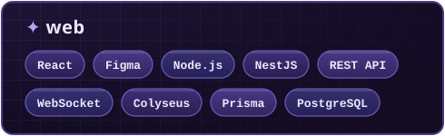</td></tr>
<tr><td align="center" valign="top">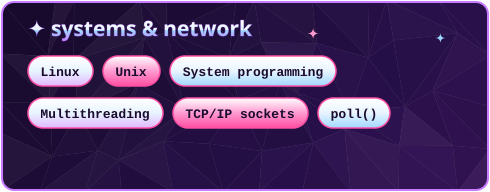</td><td align="center" valign="top">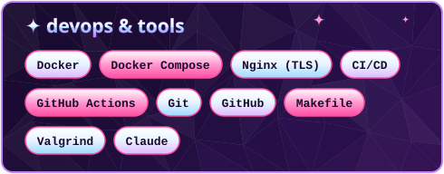</td></tr>
<tr><td align="center" valign="top" colspan="2"></td></tr>
</table>

<table width="100%">
<tr><td align="center" valign="top"><a href="https://github.com/lcalero42/ft_transcendence">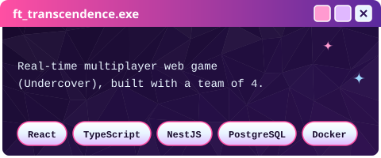</a></td><td align="center" valign="top"><a href="https://github.com/lcalero42/cub3d">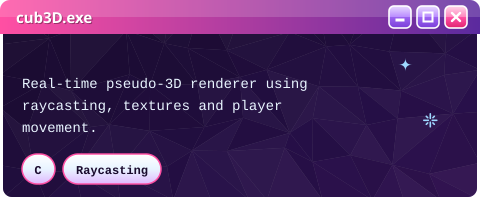</a></td></tr>
<tr><td align="center" valign="top"><a href="https://github.com/lcalero42/Minishell"></a></td><td align="center" valign="top"><a href="https://github.com/ketodin/ft_IRC"></a></td></tr>
</table>

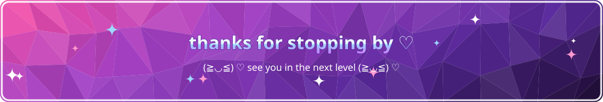

